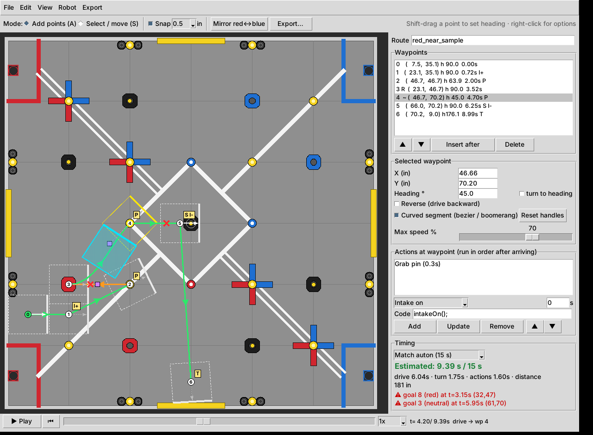

# Override Auton Planner

Desktop route planner for **VEX V5RC Override (2026-27)** autonomous routines.
Field and game-element geometry come from the official Appendix A drawings (released 2026-04-27).



## Run

Requires Python 3.10+ with Tkinter (no other dependencies).

```bash
python -m override_planner
```

```bash
python -m override_planner examples/red_near_sample.json
```

Linux without Tkinter: `sudo apt install python3-tk`.

## Using it

| Action | How |
|---|---|
| Add waypoint | Mode **Add points** (key `A`), click the field. First point = start pose |
| Move waypoint | Drag it (any mode). Arrow keys nudge by the snap size |
| Set heading | **Shift-drag** from a waypoint, or type it in the inspector ("turn to heading") |
| Reverse / curve | Right-click a waypoint, or the inspector checkboxes |
| Bezier shape | Drag the purple handles of a curved segment. End handle sets the final heading |
| Actions | Right-click → *Add action*, or the inspector's action panel (type, duration, C++ code) |
| Speed limit | Inspector *Max speed %* (per segment into the waypoint) |
| Mirror red ↔ blue | Toolbar / Edit menu |
| Playback | ▶ Play, scrub the slider, `Space` on the canvas |
| Undo / redo | `Ctrl+Z` / `Ctrl+Y` |
| Save / open | `.json` route files (also stores the robot settings) |

Time estimates use a trapezoidal profile from **Robot → Robot settings** (size, max velocity/acceleration,
turn rate) plus action durations, compared to 15 s (match) or 60 s (skills).
Red ✕ marks show where the robot footprint hits a wall or goal (toggle in **View**).

## Coordinates

* Planner/drawings: inches, origin = bottom-left corner seen from the audience, +Y toward the far wall.
* Heading: 0° = far wall, clockwise positive (matches LemLib / JAR / EZ odometry with an inertial sensor).
* Exports offer origin **field center** (default) or **bottom-left**.

## Exports (Export menu)

| Format | Output |
|---|---|
| LemLib (PROS) | `setPose`, `turnToPoint`, `moveToPoint`, `moveToPose` (curves), `turnToHeading`, `waitUntilDone` |
| JAR-Template (VEXcode) | `set_coordinates`, `turn_to_point`, `drive_to_point`, `drive_to_pose`, `turn_to_angle`, `drive_distance` for reverse |
| EZ-Template (PROS) | `odom_xyt_set`, `pid_turn_set`, `pid_odom_set` (points / boomerang poses), `pid_wait` |
| JSON | Waypoints, sampled curve paths, timed motion steps |
| CSV | One row per waypoint |

Timeouts = estimated time × 1.5 + 300 ms. Actions emit their C++ snippet (e.g. `intakeOn();`) followed by a
delay for their duration; implement those helpers in your robot code or edit the snippet per action.

## Field data

Edit `override_planner/config/` — no code changes needed:

* `field_layout.json` – goals, toggles, loaders, tape lines, starting scoring objects (head-to-head layout).
  Center goal is assumed to be the tall (8.77 in) goal, other neutral goals 5.77 in, alliance goals 3.25 in.
* `elements.json` – pin, cup, goal, toggle and loader dimensions.
* `robot.json` – default robot model.

## Tests

```bash
python -m pytest tests
```
